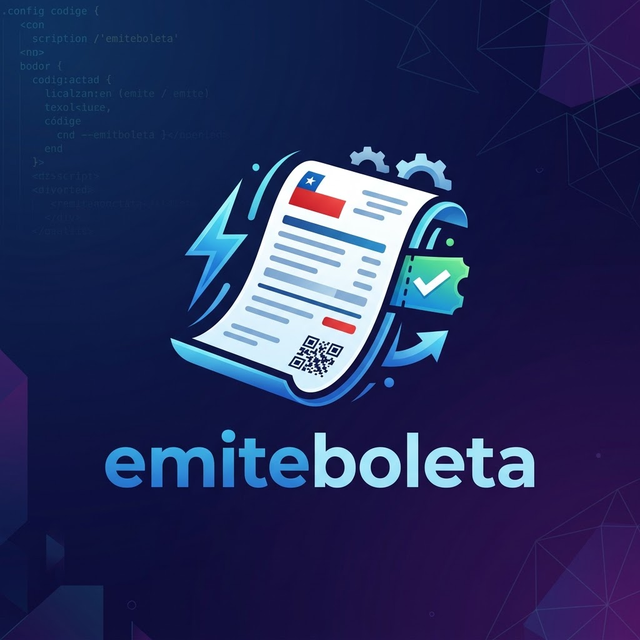
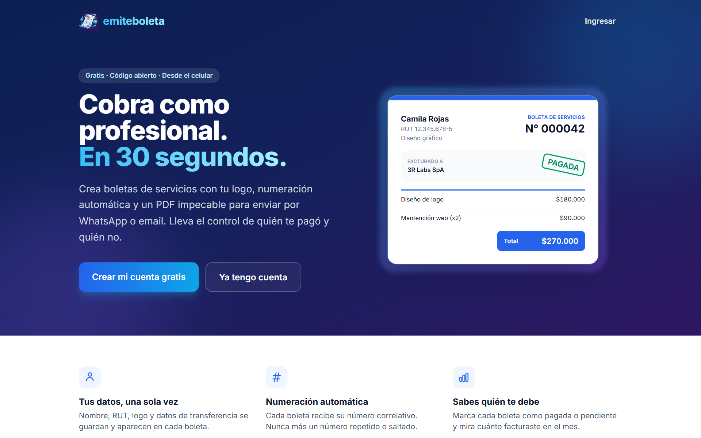
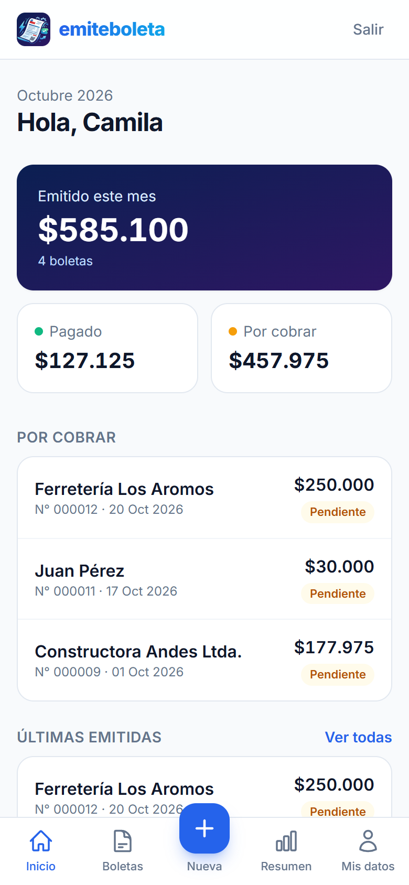
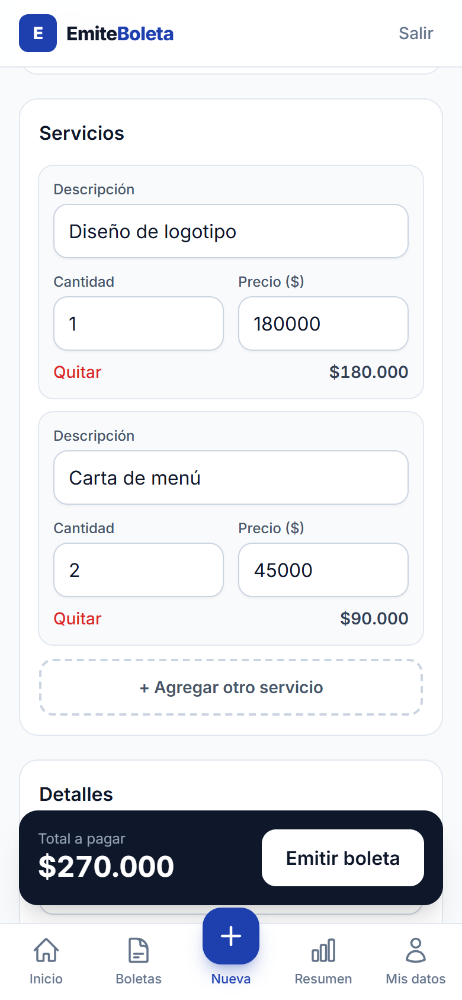
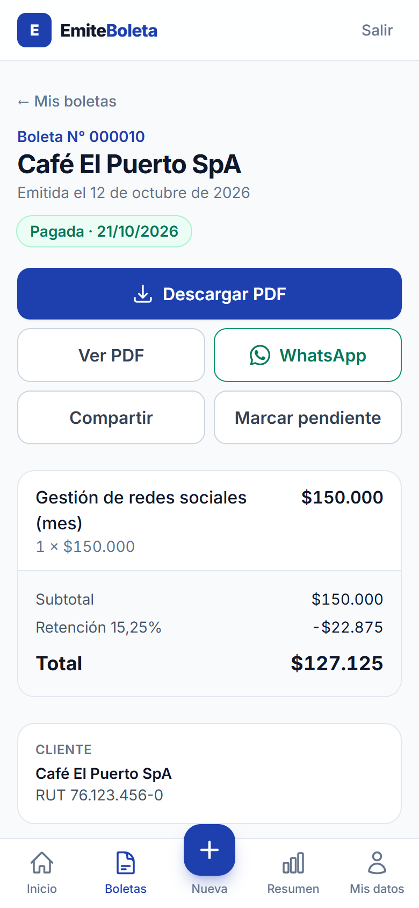
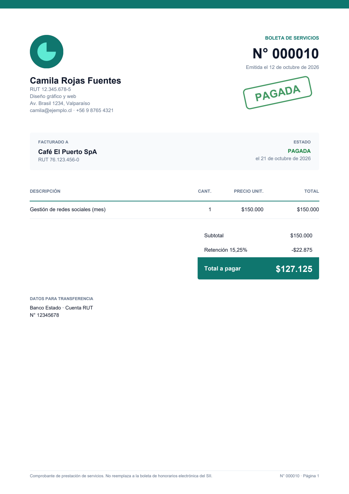
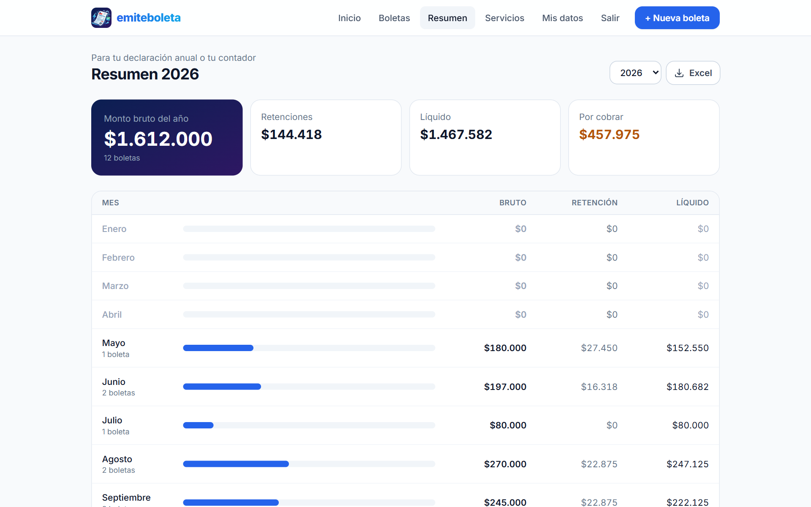

<div align="center">



# EmiteBoleta

**Boletas de servicios en PDF, desde el celular, en 30 segundos.**

[](https://github.com/y-jeff/emiteboleta/actions/workflows/ci.yml)


[](LICENSE)




</div>

## El problema

En Chile, miles de trabajadores independientes —gasfíteres, profesores particulares, diseñadoras, técnicos— cobran con un mensaje de WhatsApp o una plantilla de Word mal armada. No llevan registro de quién les pagó, repiten números de boleta y pierden tiempo rellenando siempre los mismos datos. Y el **80 % trabaja solo desde el celular**.

EmiteBoleta es una app web *mobile-first*, **gratuita y de código abierto**, que resuelve eso: completas tus datos una vez y desde ahí cada boleta toma 30 segundos, con un PDF que parece hecho por un diseñador.

> EmiteBoleta genera comprobantes de prestación de servicios. **No reemplaza** la boleta de honorarios electrónica del SII cuando corresponda emitirla.

## Capturas

<table>
  <tr>
    <td align="center"><br><sub>Totales del mes y boletas por cobrar</sub></td>
    <td align="center"><br><sub>Catálogo de servicios y total en vivo</sub></td>
    <td align="center"><br><sub>PDF, WhatsApp y estado de pago</sub></td>
  </tr>
</table>

<table>
  <tr>
    <td align="center" width="50%"><br><sub>PDF generado con ReportLab</sub></td>
    <td align="center" width="50%"><br><sub>Resumen anual para la declaración de renta</sub></td>
  </tr>
</table>

## Funcionalidades

| | |
|---|---|
| 🧾 **Boletas completas** | Varios servicios por boleta, retención opcional, notas y numeración correlativa automática |
| 📄 **PDF profesional** | Logo, color de acento a elección, sello «PAGADA» y datos para transferencia |
| 📱 **Hecha para el celular** | Navegación inferior tipo app, botones al alcance del pulgar, instalable como PWA |
| 💬 **Envío inmediato** | Botón de WhatsApp con mensaje listo y «Compartir» nativo para mandar el PDF |
| 💰 **Control de cobros** | Estado pagada / pendiente, panel con lo emitido, pagado y por cobrar en el mes |
| 📊 **Resumen anual** | Bruto, retención y líquido por mes, con exportación a Excel |
| 👤 **Tus datos una vez** | Perfil de emisor reutilizable y autocompletar clientes anteriores |
| ⚡ **Catálogo de servicios** | Guarda lo que cobras seguido y agrégalo a la boleta con un toque |
| 🔐 **Cuentas** | Registro con email, recuperación de contraseña y aislamiento total entre usuarios |

## Decisiones técnicas

- **Numeración sin colisiones.** El número se asigna dentro de una transacción con `select_for_update` sobre el perfil, y además nunca baja del máximo emitido, aunque el usuario cambie su contador.
- **Boletas inmutables ante cambios de perfil.** Cada boleta guarda una copia de los datos del emisor al momento de emitirse.
- **Montos en pesos enteros.** Se usa `Decimal` con redondeo `ROUND_HALF_UP` para cantidades fraccionarias y retenciones, sin errores de punto flotante.
- **Logo en la base de datos.** Render y Railway tienen disco efímero, así que el logo se guarda como binario y se valida con Pillow (formato y tamaño).
- **Configuración 12-factor.** Todo lo sensible viene de variables de entorno, el mismo código corre en SQLite local y en PostgreSQL en producción.
- **CSS compilado.** Tailwind se compila a un archivo estático servido por WhiteNoise con compresión y nombres con hash; CI verifica que esté al día.
- **Validación de RUT.** Algoritmo módulo 11 con formato automático (`123456785` → `12.345.678-5`).

## Stack

| Capa | Tecnología |
|------|------------|
| Backend | Django 6 · Python 3.13 |
| Base de datos | PostgreSQL (producción) · SQLite (local) |
| PDF | ReportLab |
| Interfaz | Tailwind CSS · JavaScript sin frameworks |
| Infraestructura | Render + Neon (plan gratuito) · Gunicorn · WhiteNoise · GitHub Actions |

## Correr en local

```bash
git clone https://github.com/y-jeff/emiteboleta.git
cd emiteboleta
python -m venv .venv
# Windows: .venv\Scripts\activate   ·   macOS/Linux: source .venv/bin/activate
pip install -r requirements.txt

export DEBUG=1              # PowerShell: $env:DEBUG = "1"
python manage.py migrate
python manage.py crear_demo # cuenta de ejemplo con datos
python manage.py runserver
```

Abre http://127.0.0.1:8000 e ingresa con la cuenta demo:

| Email | Clave |
|-------|-------|
| `demo@example.com` | `demo-emiteboleta` |

El comando `crear_demo` reinicia la cuenta cada vez que lo corres.

### Tests

```bash
DEBUG=1 python manage.py test
```

Cubren validación de RUT, formato de montos, numeración correlativa, totales con retención, generación de PDF, resumen y exportación, recuperación de contraseña y aislamiento entre usuarios. En CI corren sobre PostgreSQL.

### Estilos

Si cambias clases de Tailwind en las plantillas, recompila el CSS con el [ejecutable standalone de Tailwind](https://github.com/tailwindlabs/tailwindcss/releases/tag/v3.4.17) (no requiere Node):

```bash
tailwindcss -i static/src/app.css -o static/css/app.css --minify
```

## Deploy gratis

La app se puede publicar **sin costo** con [Render](https://render.com) (web) y [Neon](https://neon.com) (PostgreSQL). La guía paso a paso está en **[docs/deploy-gratis.md](docs/deploy-gratis.md)**; en resumen:

1. Crea una base de datos gratis en Neon y copia su URL.
2. En Render, **New → Blueprint** con este repositorio y pega la URL cuando la pida.
3. Listo: cada push a `main` se publica solo en `https://<nombre>.onrender.com`.

| Variable | Requerida | Descripción |
|----------|-----------|-------------|
| `SECRET_KEY` | Sí | Render la genera sola |
| `DATABASE_URL` | Sí | URL de PostgreSQL (Neon) |
| `ALLOWED_HOSTS`, `CSRF_TRUSTED_ORIGINS` | Solo con dominio propio | `tu-dominio.cl` / `https://tu-dominio.cl` |
| `EMAIL_HOST`, `EMAIL_HOST_USER`, `EMAIL_HOST_PASSWORD` | No | SMTP para recuperar contraseña; sin esto los correos van al log |

También incluye un [Procfile](Procfile) por si prefieres Railway u otro hosting compatible.

## Código abierto

EmiteBoleta es **gratis y de código abierto** bajo la [licencia MIT](LICENSE): puedes usarlo, estudiarlo, adaptarlo y publicar tu propia instancia. El proyecto y sus derechos de autor siguen siendo de su autor; la licencia solo pide mantener el aviso de copyright.

¿Encontraste un error o tienes una idea? [Abre un issue](https://github.com/y-jeff/emiteboleta/issues/new/choose). Los pull requests son bienvenidos.

## Flujo de trabajo

| Rama | Uso |
|------|-----|
| `main` | Producción. Recibe merges desde `develop` cuando una versión está lista, cada uno con su tag (`v0.1.0`, `v0.2.0`, …). |
| `develop` | Desarrollo. Aquí se integran las funcionalidades nuevas. |

Los cambios de cada versión están en el [CHANGELOG](CHANGELOG.md).

## Estructura

```
config/       Settings por variables de entorno, URLs raíz
cuentas/      Registro, ingreso y recuperación de contraseña
boletas/
  models.py   Perfil de emisor, boleta e ítems; numeración y totales
  pdf.py      Generación del PDF con ReportLab
  reportes.py Resumen anual y exportación CSV
  rut.py      Validación y formato de RUT
  management/ Comando crear_demo
templates/    Plantillas con Tailwind
static/       CSS compilado, íconos PWA y manifest
docs/         Guía de deploy gratis, logo y capturas para este README
```

## Próximos pasos

- [ ] Envío de la boleta por email desde la app
- [ ] Integración con un proveedor certificado para emitir documentos tributarios electrónicos
- [ ] Recordatorios automáticos de boletas pendientes
- [ ] Modo oscuro

## Licencia

[MIT](LICENSE)
